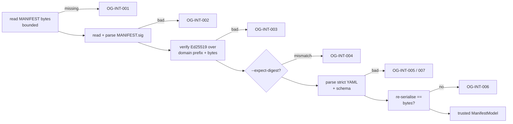
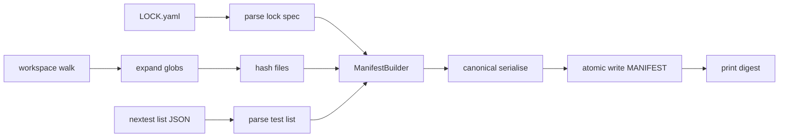

# Architecture

oracle-guard is a **functional core with an imperative shell**. The shell does all I/O: it
gathers observations (bytes, file stats, parsed reports) into plain values. The core judges those
values and returns findings. The core never touches the file system, the environment, the clock
or the process.

Component responsibilities are in [responsibilities.md](responsibilities.md). The decisions are
in [ADR-0001](../adr/ADR-0001-pure-offline-cli.md) and
[ADR-0006](../adr/ADR-0006-gate-result-conformance-and-fail-closed.md).

## Business logic

Pure, deterministic and fully unit-testable without a file system.

- **Domain values:**
  - RepositoryPath, Sha256Digest, ManifestDigest
  - BinaryId, TestName, TestId, LockedPrefix, RequirementId
  - ManifestModel, Policy (v1 constants)
  - TestOutcome, Finding, RuleId, Visibility, Status, GateResult
- **Rules:**
  - locked-prefix matching;
  - the manifest canonical form;
  - the manifest loading pipeline;
  - integrity evaluation;
  - inventory evaluation;
  - lock building;
  - result building (templates, caps, truncation, status derivation).
- **L2:** config evaluation, red-check target set and evaluation, sniff rule evaluation over
  source facts.
- **L3:** holdout planning and holdout expectations.

**Invariants the core guarantees:**

1. A ManifestModel exists only if all v1 invariants hold
   ([manifest-schema.md](manifest-schema.md#fields)).
2. A trusted ManifestModel exists only after its signature verified against the exact bytes it
   was parsed from.
3. Status is derived from findings, never set separately: any error-severity input finding gives
   `error`, otherwise any error-severity violation gives `fail`, otherwise `pass`.
4. A holdout finding cannot carry a location or a test name. The type does not allow it.
5. Finding messages are built from templates and typed placeholders only.

## External system interfaces (ports)

| Port | Purpose | Contract |
| --- | --- | --- |
| WorkspaceReader | Observe workspace files | Sorted walk without `.git/`; `lstat` semantics (no symlink following); bounded reads; reject paths outside the root |
| TrustedInputReader | Read trusted inputs | Bounded reads; paths already checked to be outside the workspace |
| SignatureVerifier | Verify the manifest (and L3 holdout set) signature | `verify(message, signature, key set, purpose) → Ok or a typed failure`. No key discovery |
| TestReportReader | Parse a test report | Returns test outcomes per test ID, or a typed malformed-input error |
| TestListReader | Parse a test list | Returns test IDs with the `ignored` and filter-match flags |
| SourceAnalyzer *(L2)* | Extract Rust source facts | Returns facts with spans, or a parse error per file |
| ConfigSectionReader *(L2)* | Extract a canonical TOML section | Returns canonical bytes or a typed error |
| WorkspaceWriter | Write the `lock` output and L3 injections | Atomic create or replace inside the root only |
| ResultSink | Write the gate result | Create-new file, or stdout |

## Infrastructure implementations

Suggested implementations. The interface designer and `.tech-decisions` may change them.

| Port | Implementation |
| --- | --- |
| Argument parsing | `clap` (derive) |
| SignatureVerifier | `ed25519-dalek` with `verify_strict`. A chain-chronicler DSSE verifier from M3 |
| TestReportReader | `quick-xml` reader with DTD and entity expansion disabled |
| TestListReader | `serde_json` with size limits |
| Strict YAML | A YAML parser that exposes anchors, aliases, tags and duplicate keys so they can be rejected (to be chosen; [tradeoffs.md](tradeoffs.md#t-2-yaml-parser-choice)) |
| Hasher | `sha2` (streaming) |
| ConfigSectionReader *(L2)* | `toml_edit` or `toml` to select the section, then canonical JSON serialisation |
| SourceAnalyzer *(L2)* | `syn` with the `full` and `visit` features |
| Globbing | `globset` with `literal_separator(true)` |

## Manifest loading pipeline

Every check that consumes a manifest uses this order. It never parses unauthenticated YAML
beyond the signature file itself.

## Data flow per command

### `lock`

### `verify`

Loading pipeline → observe each listed path (`lstat`, then hash if it is a regular file) → walk
`tests/locked/` → IntegrityEvaluator → ResultBuilder → ResultSink.

### `inventory`

Loading pipeline → parse the test report → (L3: read the holdout expectations) →
InventoryEvaluator → ResultBuilder → ResultSink.

### `config-guard`, `red-check`, `sniff` (L2)

Loading pipeline → gather observations (config hashes / stub-run report and previous manifest /
source facts) → evaluator → result.

### `holdout-inject` (L3)

Verify the holdout set → HoldoutPlanner → WorkspaceWriter (copy or replace) → write the holdout
expectations outside the workspace → result.

## Dependency rules

- The core depends on nothing outside the standard library, except pure crates that do no I/O
  (for example `sha2`).
- Adapters depend on the core. The core never depends on adapters.
- Only CommandLineAdapter reads environment variables.
- No crate that brings network or process-spawning capability is used in the core. The binary
  as a whole spawns no processes and opens no sockets
  ([constraints.md](constraints.md#boundary-rules)).

## Deployment shape

A single static binary. It is pinned by version and digest in the harness gate definition, and
installed in the gate sandbox image ([operations.md](operations.md)).
