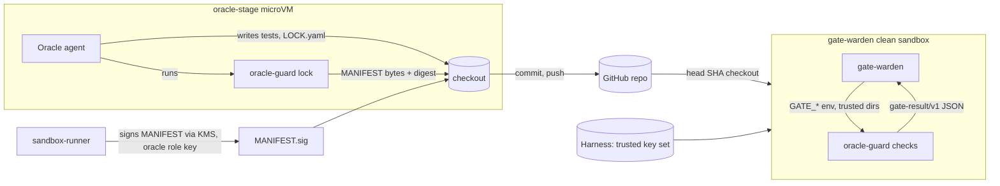

# Overview

## Purpose

oracle-guard checks the integrity of **locked software test oracles**. In Brightsmiths, unit
tests live in the implementation repository next to the code. The information barrier between
the oracle role, which writes the tests, and the build agent, which writes the code, therefore
rests on three things:

- path ownership;
- identity;
- execution evidence.

oracle-guard provides the evidence. It is a command-line tool in the Brightsmiths software
discipline pack. Its checks report in gate-warden's standard gate result format.

System context and principles are defined in the handbook:
[oracles and anti-faking](https://github.com/brightsmiths/handbook/blob/feat/initial/docs/architecture/oracles.md),
[services](https://github.com/brightsmiths/handbook/blob/feat/initial/docs/architecture/services.md),
[isolation and security](https://github.com/brightsmiths/handbook/blob/feat/initial/docs/architecture/isolation-and-security.md).

## Users

| User | Uses | Authority |
| --- | --- | --- |
| sandbox-runner, in the oracle stage | `lock`. The resulting manifest is signed outside the sandbox with the oracle role key | Produces the manifest |
| gate-warden, in a clean gate sandbox | `verify`, `inventory`; from L2 also `config-guard`, `red-check`, `sniff`; from L3 `holdout-inject` | **The only authoritative run** |
| Build agents (zone C) | Any check, for feedback | None. Never an authority |
| Humans standing in at M1 | Every command, from a shell | As the stand-in for the service |

## Commands and increments

| Command | Level | Milestone | Kind | Summary |
| --- | --- | --- | --- | --- |
| `lock` | L1 | M1 | producer | Build the unsigned manifest from the lock spec and the test list |
| `verify` | L1 | M1 | check | Check the manifest signature, the optional pinned digest and every locked file hash |
| `inventory` | L1 | M1 | check | Every expected test ran once and passed; none skipped; no unexpected locked tests |
| `config-guard` | L2 | M2 | check | Hashes of test-affecting config, whole-file or per section |
| `red-check` | L2 | M2 | check | Every targeted oracle test fails against the stubs |
| `sniff` | L2 | M2 | check | Static rules for test-only behaviour in production code |
| `holdout-inject` | L3 | M6 | preparation | Copy hidden tests into the clean gate workspace and record their IDs for `inventory` |

Scope beyond L3 belongs to "after factory role complete":

- C# and TypeScript conventions;
- DSSE envelopes once chain-chronicler is mandatory everywhere;
- more sniff rules.

## Context



oracle-guard has no network access, no GitHub client and no keys. It reads files and writes
files.

## Main flow (L1)

```mermaid
sequenceDiagram
  participant OA as Oracle agent (zone B)
  participant OG as oracle-guard
  participant SR as sandbox-runner
  participant BA as Build agent (zone C)
  participant GW as gate-warden
  OA->>OA: write locked tests, fixtures, LOCK.yaml
  OA->>OG: cargo nextest list --message-format json > list.json; oracle-guard lock
  OG-->>OA: tests/locked/MANIFEST, digest on stdout
  SR->>SR: sign signing message (KMS, oracle role key)
  SR-->>OA: tests/locked/MANIFEST.sig, digest recorded in stage attestation
  BA->>BA: implement in src/ (locked files read-only)
  BA->>OG: optional feedback runs (not authoritative)
  GW->>OG: verify --trusted-keys $GATE_HARNESS_DIR/... [--expect-digest]
  OG-->>GW: gate-result/v1 (pass/fail/error)
  GW->>GW: cargo nextest run --profile ci (JUnit)
  GW->>OG: inventory --test-report junit.xml --trusted-keys ...
  OG-->>GW: gate-result/v1
```

## What oracle-guard does not do

- It does not decide gate verdicts, publish check runs or talk to GitHub. That is gate-warden's
  job. gate-warden's GitHub integration needs nothing from oracle-guard beyond the result file.
- It does not sign anything or hold keys.
- It does not run cargo, nextest or the tests. The caller runs them and passes the outputs in.
- It does not enforce file permissions. agent-gate's mount plan does that (`0444` locked files,
  sticky directories). oracle-guard detects what got through.
- It does not judge test quality beyond red-check. Mutation testing belongs to ratchet.

## Glossary

See [vocabulary.md](vocabulary.md). Key terms:

- [manifest](vocabulary.md#manifest)
- [test ID](vocabulary.md#test-id)
- [locked prefix](vocabulary.md#locked-prefix)
- [gate result](vocabulary.md#gate-result)
- [trusted input](vocabulary.md#trusted-input)
