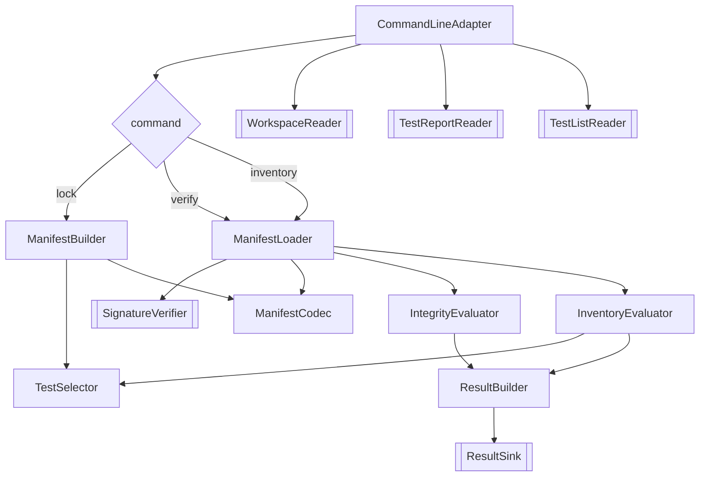

# Responsibilities (CRC)

These are the components and their responsibilities, split into what each one knows and what it
does. Component names are roles, not prescribed type names. The interface designer decides the
concrete types and modules. Layers are defined in [architecture.md](architecture.md).

## Core (pure business logic)

### ManifestModel

- **Knows:** the manifest content (files, test config entries, locked prefixes, expected tests,
  sniff allowlist, policy) and the v1 invariants:
  - sorted entries, unique keys;
  - every expected test is inside a locked prefix;
  - policy constants;
  - valid repository paths.
- **Does:** validates itself on construction, so an invalid manifest cannot be represented.
  Answers "is this test ID locked?", "is it expected?" and "what is its requirement ID?".
- **Collaborators:** TestSelector.
- **Roles:** the single source of truth for what the oracle is.

### ManifestCodec

- **Knows:** the strict YAML subset and the canonical form of `oracle-guard-manifest/v1`.
- **Does:** serialises a ManifestModel to canonical bytes, parses bytes into a ManifestModel,
  and rejects non-canonical input by re-serialising and comparing.
- **Collaborators:** StrictYamlReader (port).
- **Roles:** the only place that knows the manifest's byte format.

### TestSelector

- **Knows:** the locked-prefix matching rules.
- **Does:** matches test IDs against locked prefixes and requirement entries.
- **Collaborators:** none.

### ManifestBuilder (`lock`)

- **Knows:** the lock spec and the lock rules `OG-LCK-001`…`008`.
- **Does:** combines the expanded locked files and their hashes with the test list, selects the
  expected tests, assigns requirement IDs and produces a ManifestModel. It does not do I/O.
- **Collaborators:** TestSelector, GlobMatcher.

### ManifestLoader

- **Knows:** the [loading pipeline](architecture.md#manifest-loading-pipeline) order.
- **Does:** turns manifest and signature bytes into a trusted ManifestModel or an `OG-INT-001`…`007`
  violation. It verifies before it parses, then checks the pinned digest, then parses and checks
  the canonical form.
- **Collaborators:** SignatureVerifier (port), ManifestCodec, DigestCalculator.
- **Roles:** the gatekeeper that every manifest-consuming check goes through.

### IntegrityEvaluator (`verify`)

- **Knows:** the trusted manifest, and the observed state of each locked file (missing,
  non-regular, or present with a hash). It also knows the unlisted files under `tests/locked/`.
- **Does:** produces `OG-INT-008`…`011` findings and a status.
- **Collaborators:** none. Observations come from the shell.

### InventoryEvaluator (`inventory`)

- **Knows:** the policy, the expected tests, the locked prefixes, the holdout expectations (L3)
  and the parsed test outcomes.
- **Does:** classifies each expected or holdout test and each unexpected locked test into
  `OG-INV` findings. It applies holdout redaction (visibility, fixed message, no test name) at
  the moment the finding is created.
- **Collaborators:** TestSelector.

### ConfigEvaluator (`config-guard`, L2)

- **Knows:** `test_config` entries, observed file and section hashes, and the
  test-affecting-config candidates found in the workspace.
- **Does:** produces `OG-CFG` findings.
- **Collaborators:** LanguageConvention (for the candidate list).

### RedCheckEvaluator (`red-check`, L2)

- **Knows:** the current and previous manifests and the stub-run outcomes.
- **Does:** computes the red-check target set and produces `OG-RED` findings.

### SniffEvaluator (`sniff`, L2)

- **Knows:** the sniff rules, the allowlist and the source facts that SourceAnalyzer extracted.
- **Does:** applies rules, removes allowlisted findings, and reports unused allowlist entries.
- **Collaborators:** SourceAnalyzer (port).

### HoldoutPlanner (`holdout-inject`, L3)

- **Knows:** the holdout set and the current workspace layout.
- **Does:** plans the file operations (copy, or replace the placeholder), checks for collisions,
  and builds the holdout expectations.
- **Collaborators:** LanguageConvention.

### ResultBuilder

- **Knows:** gate-result/v1 field rules, message templates, the 300/200-character caps, the
  finding limits and the sort order.
- **Does:** turns findings, metrics and status into one gate result value, truncating
  deterministically. It never accepts free text, only rule IDs plus typed placeholders.
- **Roles:** the enforcer of the message content rules.

### LanguageConvention (Rust implementation)

- **Knows:**
  - how test IDs are formed (nextest binary ID and test name);
  - which files are test-affecting config;
  - the placeholder convention;
  - which sniff rules apply.
- **Does:** supplies the language-specific knowledge to the other components.
- **Roles:** the extension point ([ADR-0008](../adr/ADR-0008-language-conventions-extension-point.md)).

## Shell (infrastructure adapters)

### CommandLineAdapter

- **Does:**
  - parses arguments;
  - resolves the three `GATE_*` variables;
  - checks that trusted inputs lie outside the workspace;
  - maps statuses to exit codes;
  - catches panics and turns them into `OG-INP-009`.
- **Collaborators:** every command handler.

### WorkspaceReader

- **Does:**
  - walks the workspace in sorted order (excluding `.git/`);
  - stats paths without following symlinks;
  - reads bytes with size limits;
  - refuses paths that escape the root.
- **Roles:** the only file system access for workspace content.

### TrustedInputReader

- **Does:** reads the trusted key set, the previous manifest and the holdout set from outside the
  workspace, with size limits.

### SignatureVerifier (port) / Ed25519Verifier (adapter)

- **Does:** verifies a signature over the signing message using the trusted key set. Rejects
  wrong algorithms, unknown key IDs, keys without the needed purpose, and weak keys. Uses strict
  verification.
- **Future adapter:** DsseVerifier through chain-chronicler (M3).

### TestReportReader (port) / NextestJunitReader (adapter)

- **Does:** streams JUnit XML with DTDs and entities disabled, maps `<testcase>` elements to
  test IDs and outcomes, and rejects malformed input.

### TestListReader (port) / NextestListReader (adapter)

- **Does:** parses nextest list JSON into test IDs plus `ignored` and filter-match flags.

### Hasher

- **Does:** streaming SHA-256 of files, and canonical section hashing (L2).

### SourceAnalyzer (port, L2) / RustSynAnalyzer (adapter)

- **Does:** parses Rust source and extracts facts for SniffEvaluator: cfg attributes and their
  targets, macro calls, environment reads, string literals and paths, with spans.

### WorkspaceWriter

- **Does:** writes files atomically. Used for the `lock` output and the L3 holdout injection.

### ResultSink

- **Does:** writes the gate result to the result file (create-new, no overwrite) or to stdout.

## Collaboration summary

